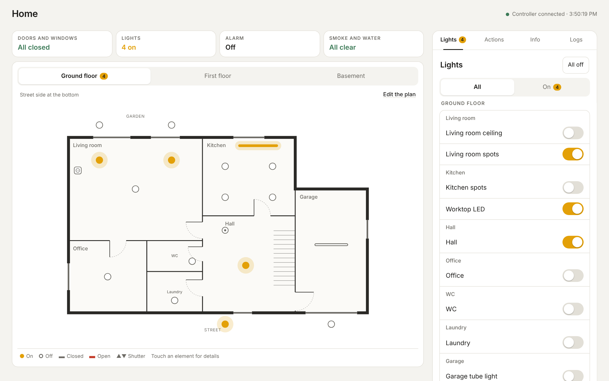
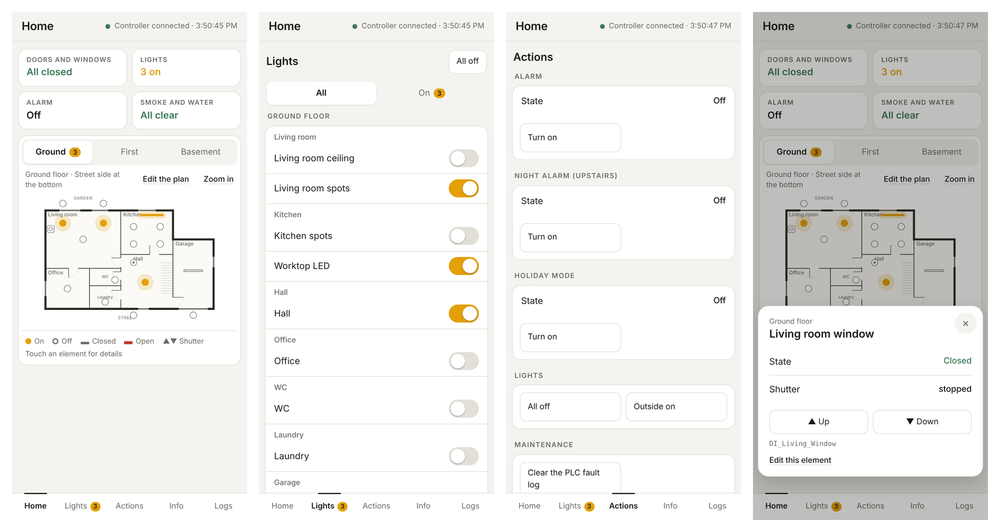
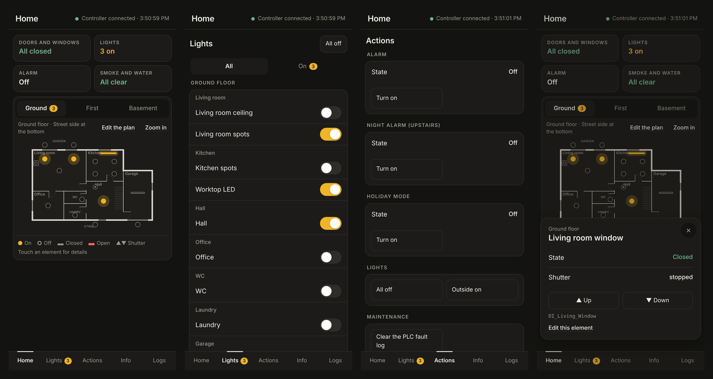
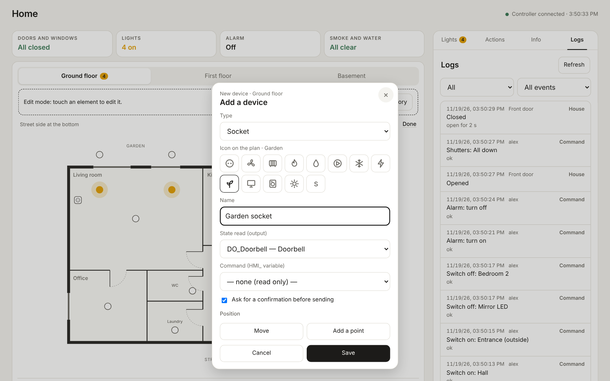
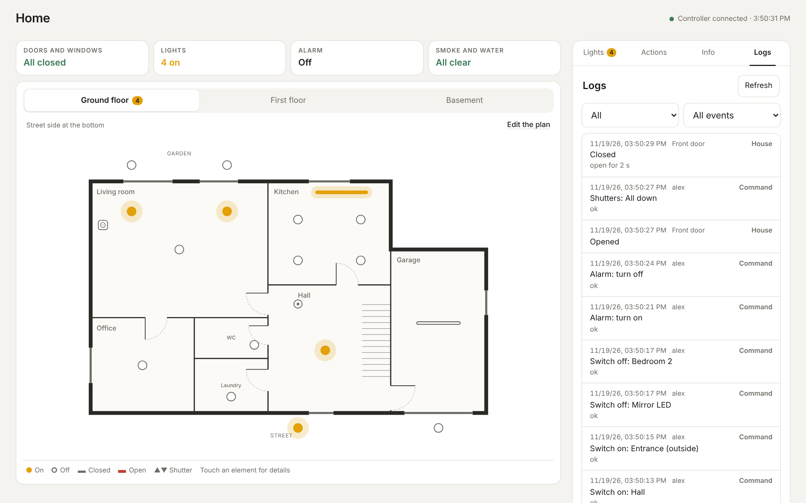
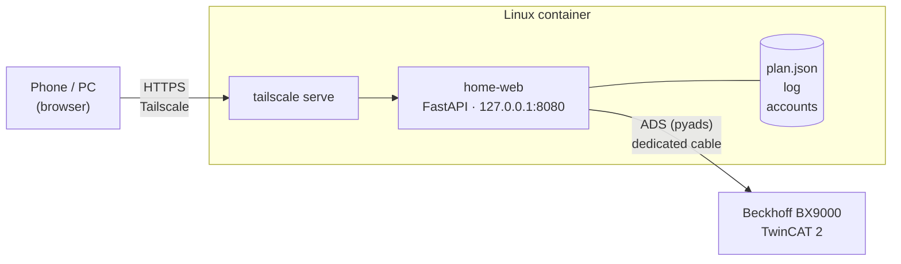

# home-web

**Web interface for a house run by a Beckhoff PLC.** An interactive plan of each floor, the live state of lights, doors, windows, shutters and detectors, and safe commands from a phone.



<sub>Screenshots taken in demo mode, with the example house of the repository and simulated data. Every variable name is made up.</sub>

## In short

- **The plan is the interface.** Each floor is drawn to scale. Lamps light up on the plan, open windows turn red, and you touch an element to control it.
- **The real state, not a guess.** The server reads the controller every second (inputs, outputs, flags) and the page shows nothing it cannot read.
- **Commands without surprises.** Each command is a 100 ms pulse on a PLC variable that the program handles like a button press. The server reads the state again just before sending and sends nothing if it is already the requested one.
- **The house rules stay out of reach.** Forbidden outputs, mandatory confirmations and fixed functions live in a rules file that the page cannot change, even for an admin.
- **Several accounts, two roles.** Users see and control. Admins also edit the plan from the page and read the log.
- **Nothing exposed to the Internet.** The service only listens locally and is only reachable over HTTPS through Tailscale.

## Screenshots

**On a phone**: the house, the lights, the actions and the sheet of a window with its shutter.



<p align="center"></p>

**Edit mode (admins)**: add a device by touching the plan, choose its type and icon, link its variable.



**Log (admins)**: logins, commands and their result, plan edits, every door opened or closed.



## Features

**See**
- Plan per floor: lights, doors and windows, garage door, moving shutters, smoke and water detectors.
- Four summary tiles: openings, lights on, alarm (off, on, ringing), smoke and water.
- Lists per room, "on" filter, alarm and holiday mode state.
- Light or dark theme from the system, designed for the phone first, two columns on a desktop.
- English or French interface (`HOMEWEB_LANG`).

**Control**
- Lamps and devices (switch), shutters one by one or by group, garage door (open / close), scenes (all lights off, outside lights on…).
- Confirmation for sensitive commands: alarm, garage, heater, pumps.

**Administer from the page**
- Add a lamp, an LED or a device (socket, fan, heater, pump…) with its icon, move, rename, link another variable, link a window to a shutter.
- History of the last 100 versions of the plan, roll back in one click.
- Filterable log kept 12 months, with every door and window opened or closed and the alarm siren.

## How it works



1. A background thread reads the controller every second: input image, output image and the `%M` area of the command variables. Names and addresses come from the `.tpy` file TwinCAT writes at each build.
2. After login the page polls `/api/state` and draws the plan. Browsers never talk to the controller.
3. A command goes through `/api/cmd`: whitelist, role and confirmation checks, controller in RUN, state read again, pulse, then a check that the output did change.

Details, safeguards and how to add a command: [docs/HOW-IT-WORKS.md](docs/HOW-IT-WORKS.md).

## Security

- The service listens on `127.0.0.1` only. HTTPS access through `tailscale serve`, no port forwarding on the router.
- Passwords stored as scrypt hashes. Blocked after 5 failed attempts per account, or 20 in total, for 15 minutes.
- Session held in memory by the page (no cookie, so no CSRF), 12 h at most. Each account can be tied to a Tailscale account.
- Role checked again by the server at each request. Every refused attempt is logged.
- Whitelist of variables: never a write into an output or a state. Forbidden outputs and mandatory confirmations come from the rules file, which edit mode cannot change.
- Command bits reset to 0 at each connection and watched: a command whose bit stays at 1 is blocked.
- Strict Content-Security-Policy, HSTS, hardened systemd unit (user without a shell, read-only file system).

## Try it locally (demo mode)

No controller needed: the server simulates the example house (lamps that change, a front door that opens, shutters, garage door).

```bash
git clone https://github.com/lorisknodt/home-web.git && cd home-web
python3 -m venv .venv && . .venv/bin/activate
pip install fastapi uvicorn
HOMEWEB_DEMO=1 HOMEWEB_TPY=examples/house.tpy uvicorn app.main:app --port 8080
```

Open <http://127.0.0.1:8080>. Without an accounts file, any login works, as admin (demo mode only). Add `HOMEWEB_LANG=fr` for the French interface.

## Install it for real

Step by step in a Proxmox container, Tailscale access, accounts and updates: [docs/INSTALL.md](docs/INSTALL.md).

What belongs to one house stays **out of this repository**, on the server or in a private repository:

| File | Role | Example in the repository |
|---|---|---|
| `house.tpy` | symbols of the PLC program | `examples/house.tpy` (built by `examples/make_tpy.py`) |
| `rules.json` | forbidden outputs, confirmations, functions, garage, siren, alerts | `examples/rules.json` |
| `house.json` | walls, rooms, inner doors, stairs | `examples/house.json` |
| `plan_default.json` | lamps, devices, openings, detectors, shutters at first start | `examples/plan.json` |

## Layout

```
app/
  main.py          server: login, roles, state, commands, plan, log
  rules.py         house rules (rules.json): forbidden outputs, confirmations, functions, garage, states
  plan.py          editable plan: format, validation, history, allowed commands
  plc.py           reading the controller, pulses, watchdog, simulated controller
  accounts.py      accounts (file + console tool)
  eventlog.py      event log
  tpy.py           reading the TwinCAT symbol file
  i18n.py          server texts in English and French
  static/index.html  the page (HTML, CSS and JavaScript, no dependency)
examples/          example house, rules and fake .tpy for the demo
tools/check_tpy.py check a .tpy, address table, TwinCAT declarations
tools/update.sh    server update in one command (git pull, rights, restart)
docs/              install, how it works, guide for the PLC program, screenshots
```

Python 3.11+, FastAPI, uvicorn and pyads on the server. On the page side, a single HTML file without a framework or external dependency.

## Documentation

- [Install and run](docs/INSTALL.md)
- [How it works and safeguards](docs/HOW-IT-WORKS.md)
- [Guide for the PLC program](docs/PLC-GUIDE.md)
